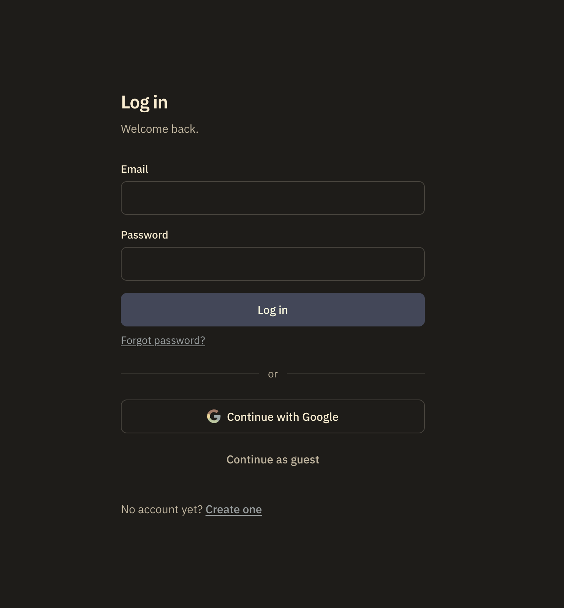
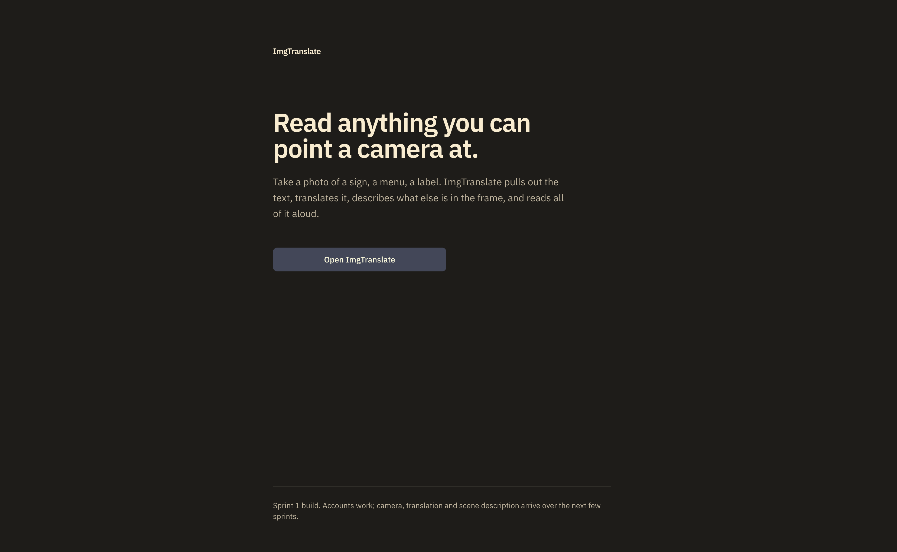
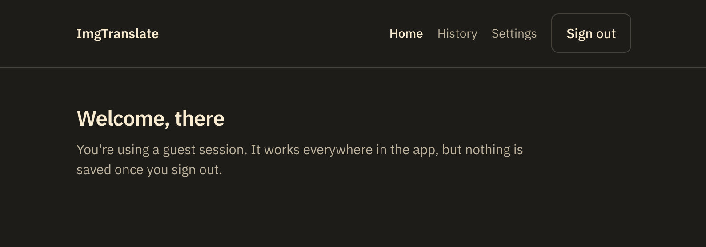
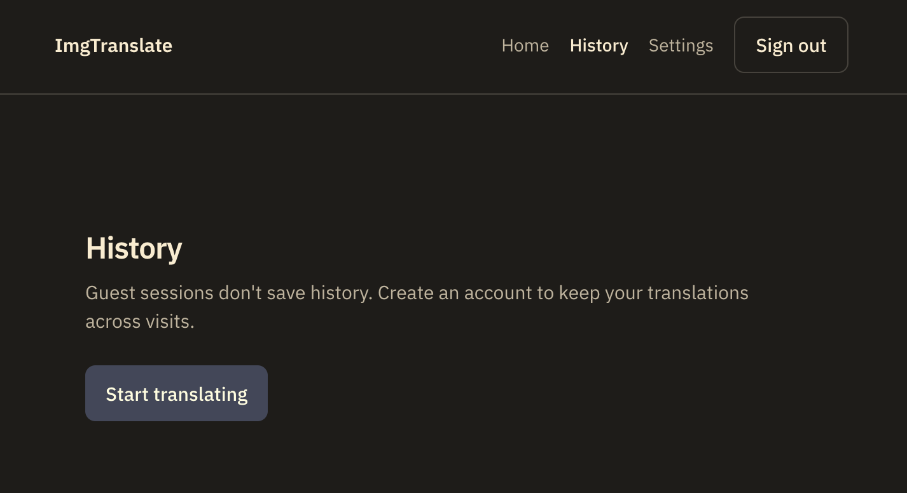
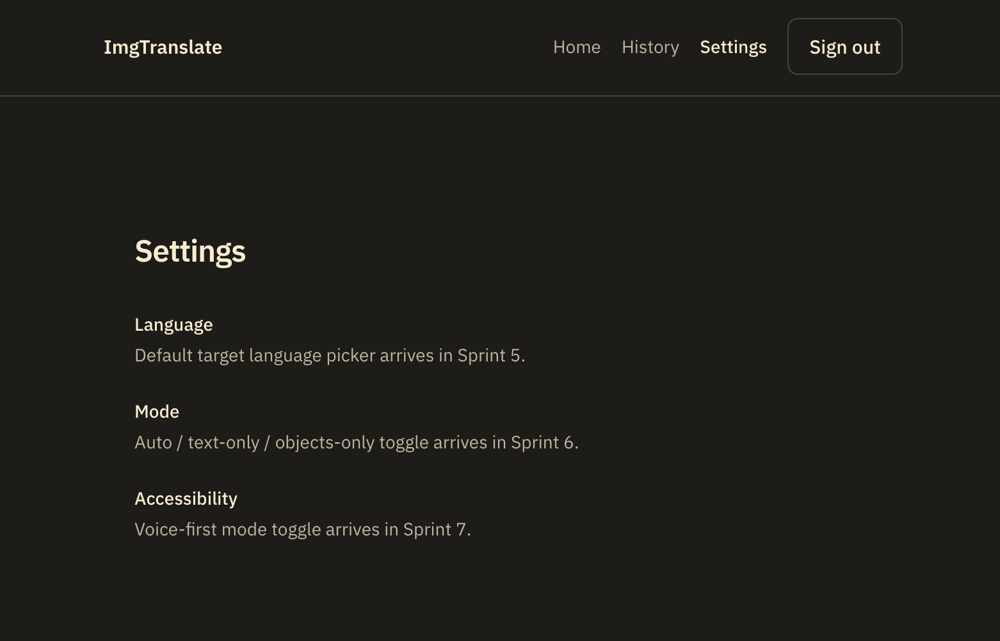

# ImgTranslate

**Point a camera at text you can't read.** ImgTranslate extracts it, translates it, describes the surrounding scene, and reads all of it aloud — designed from the ground up as an accessibility tool for blind and low-vision users, not a translator with accessibility added on afterward.


---

## Table of Contents
- [Overview](#overview)
- [Screenshots](#screenshots)
- [Current Status](#current-status)
- [Why This Project Exists](#why-this-project-exists)
- [Tech Stack](#tech-stack)
- [Architecture](#architecture)
- [Academic Context](#academic-context)
- [Engineering Process](#engineering-process)
- [Team](#team)
- [Getting Started](#getting-started)
- [Project Structure](#project-structure)
- [Development Notes](#development-notes)
- [License](#license)

## Overview

ImgTranslate is a full-stack web application that lets a user photograph any image containing text — a sign, a menu, a label — and get back extracted text, a translation into their chosen language, a plain-language description of the surrounding scene, and all of it read aloud. It's being built across two semesters at Syracuse University: a formal software-design phase (CIS 453) followed by an Agile implementation phase (CIS 454).

## Screenshots

| Login | Landing |
|---|---|
|  |  |

| Authenticated Home | History |
|---|---|
|  |  |

| Settings |
|---|
|  |

## Current Status

This project is in active development as part of an ongoing course. The table below is accurate as of the most recent sprint — not aspirational.

| Feature | Status |
|---|---|
| Authentication (email/password, Google, guest) | ✅ Done |
| Protected routes, Firestore user profiles, security rules | ✅ Done |
| Shared UI component library | ✅ Done |
| Password reset | ✅ Done |
| History / Settings pages (skeleton) | ✅ Done |
| Image input (file upload, camera, clipboard paste) | 🔄 In progress |
| OCR (Google Cloud Vision) | ⏳ Planned |
| Translation (Google Cloud Translation) | ⏳ Planned |
| Scene description (Gemini) | ⏳ Planned |
| Text-to-speech / voice-first accessibility mode | ⏳ Planned |
| Tap-to-correct OCR segments | ⏳ Planned |
| Area selection & language auto-detection | ⏳ Planned |
| PWA / offline support | ⏳ Planned |

## Why This Project Exists

Most translation apps treat accessibility as an afterthought. ImgTranslate's voice-first mode — full text-to-speech, a stripped-down high-contrast interface, and complete keyboard navigation — is a first-class design target from the project's original requirements, not a feature bolted on at the end. The scene-description feature exists specifically to give a blind or low-vision user context a sighted user would get for free just by looking at an image.

## Tech Stack

- **Frontend:** Next.js 14 (App Router), TypeScript (strict mode), Tailwind CSS
- **Backend:** Firebase (Authentication, Firestore, Storage)
- **Planned integrations:** Google Cloud Vision (OCR), Google Cloud Translation, Gemini (scene description), Web Speech API (TTS)
- **Deployment:** Vercel, CI/CD via GitHub Actions
- **Project management:** Jira (Scrum)

## Architecture

The codebase follows an MVVM-inspired separation:
lib/ → Model: Firebase calls, business logic, types. No JSX.
hooks/ → ViewModel: reactive state, calls lib/ only.
components/ → View: JSX only. Never calls Firebase directly.
app/ → Routes (Next.js App Router).

This split is enforced by convention and checked in code review: `lib/` never imports React, and `components/` never imports from `firebase/*` directly.

## Academic Context

ImgTranslate is a two-semester project at Syracuse University (Team TM01):

- **CIS 453 — Software Engineering I (Spring 2026):** Formal software design phase. Produced use case diagrams, activity diagrams, CRC cards, and UML class/sequence diagrams in Visual Paradigm, along with full requirements traceability from user requirements through system requirements to implementing classes.
- **CIS 454 — Software Engineering II (Fall 2026, in progress):** Agile implementation phase. The CIS 453 design is being built out across a 12-sprint, one-week-per-sprint release plan, managed in Jira using Scrum.

## Engineering Process

- **Agile/Scrum:** One-week sprints tracked in Jira, with sprint planning, daily async standups, and retrospectives every sprint.
- **CI/CD:** Every pull request is gated on automated TypeScript type-checking, linting, and a full production build via GitHub Actions, with Vercel preview deploys on every PR.
- **Parallel-first development:** Rather than a sequential workflow where teammates block on each other's unfinished work, features are split into isolated files owned by a single person, with lightweight placeholder ("stub") components used wherever one person's work depends on a piece a teammate hasn't finished yet — allowing simultaneous development with zero merge conflicts.

## Team

- **Adriel Pacheco** — Team Lead
- **Chad Saunders**
- **Mark Vu**
- **Andy Kocak**

## Getting Started

```bash
git clone https://github.com/<org-or-user>/imgtranslate.git
cd imgtranslate
npm install
cp .env.example .env.local   # fill in Firebase config — see .env.example for required keys
npm run dev
```

Open [http://localhost:3000](http://localhost:3000).

## Project Structure
app/ # Next.js routes
components/ # View layer — UI, auth forms, layout
hooks/ # ViewModel layer — React state hooks
lib/ # Model layer — Firebase, business logic, types
docs/ # Setup guides, coding conventions, screenshots
artifacts/ # Per-sprint evidence (screenshots, demo recordings) for course grading

## Development Notes

Parts of this project's planning, documentation, and initial scaffolding were developed with AI assistance (Claude). All architectural decisions, code review, testing, and final implementation are the team's own work.

## License

MIT — see [LICENSE](LICENSE).
